# 画面遷移図

[画面設計](screen.md) の画面構成をもとにした、MVP の画面遷移です。GitHub ではこの図がそのまま描画されます。

```mermaid
stateDiagram-v2
    direction LR
    [*] --> 問題一覧 : アプリを開く（/）

    問題一覧 --> 解答中 : [解く]（/questions/{id}）
    解答中 --> 答え合わせ後 : [答え合わせ]
    答え合わせ後 --> 解答中 : [もう一度解く]
    解答中 --> 問題一覧 : [← 一覧へ]（埋めた空欄があれば確認）
    答え合わせ後 --> 問題一覧 : [一覧へ戻る] / [← 一覧へ]

    問題一覧 --> 読み込みエラー : 一覧の取得に失敗
    解答中 --> 読み込みエラー : 問題が見つからない・取得に失敗
    読み込みエラー --> 問題一覧 : [一覧へ戻る]

    問題一覧 --> ログイン : [ログイン]
    問題一覧 --> 新規登録 : [新規登録]
    ログイン --> 新規登録 : [新規登録]
    新規登録 --> ログイン : [ログイン]
    ログイン --> 問題一覧 : ログインできた（元の画面へ）
    新規登録 --> 問題一覧 : 登録できた（元の画面へ）

    state 問題画面 {
        解答中
        答え合わせ後
    }
```

問題画面の [ログイン] [新規登録] からも同じように移り、ログイン・登録の後は問題画面に戻ります（図では問題一覧だけを描いています）。[ログアウト] は画面を移らず、ヘッダーの表示だけが変わります。

画面幅が 1024px 未満のときは、どの画面でも「PCで開いてください」だけを表示します（図には描いていません）。幅を広げると元の画面に戻ります。

## 遷移の一覧

| 遷移元 | 操作・きっかけ | 遷移先 | URL | サーバーとの通信 |
| --- | --- | --- | --- | --- |
| （起動） | アプリを開く | 問題一覧 | `/` | GET /api/questions |
| 問題一覧 | 問題の [解く] | 問題画面（解答中） | `/questions/{id}` | GET /api/questions/{id} |
| 解答中 | [答え合わせ] | 答え合わせ後 | 変わらない | POST /api/questions/{id}/attempts |
| 答え合わせ後 | [もう一度解く] | 解答中（空欄は空） | 変わらない | なし |
| 解答中 | [← 一覧へ]（空欄を1つでも埋めていたら確認を出し、OKのとき） | 問題一覧 | `/` | GET /api/questions |
| 答え合わせ後 | [← 一覧へ] / [一覧へ戻る] | 問題一覧 | `/` | GET /api/questions |
| 問題一覧・解答中 | 通信の失敗、存在しない問題 | 読み込みエラー | 変わらない | なし |
| 読み込みエラー | [一覧へ戻る] | 問題一覧 | `/` | GET /api/questions |
| （起動） | アプリを開く（どの画面でも） | 変わらない | 変わらない | GET /api/me |
| 問題一覧・問題画面 | ヘッダーの [ログイン] / [新規登録] | ログイン / 新規登録 | `/login?next=元のパス` / `/signup?next=元のパス` | なし |
| ログイン | [ログイン]（成功） | 元の画面 | `next` のパス（なければ `/`） | POST /api/login |
| 新規登録 | [登録する]（成功） | 元の画面 | `next` のパス（なければ `/`） | POST /api/signup |
| 問題一覧・問題画面 | ヘッダーの [ログアウト] | 変わらない | 変わらない | POST /api/logout |

## 補足

- 「解答中」と「答え合わせ後」は同じ問題画面の中の状態の違いで、URL は変わりません。
- 答え合わせ後に画面を再読み込みすると、解答中（空欄は空）から始まります。
- 「読み込みエラー」は、設計書にまだない状態として追加しています。
- 答え合わせ後に「次の問題へ」ボタンは付けない。次の問題は一覧に戻って選ぶ。
